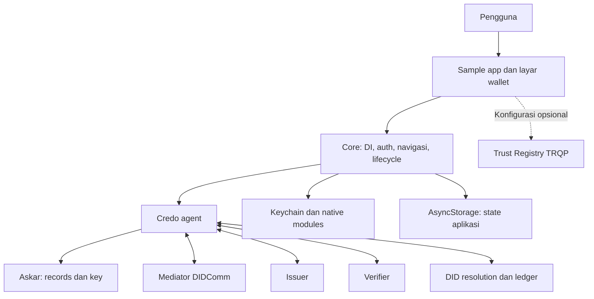
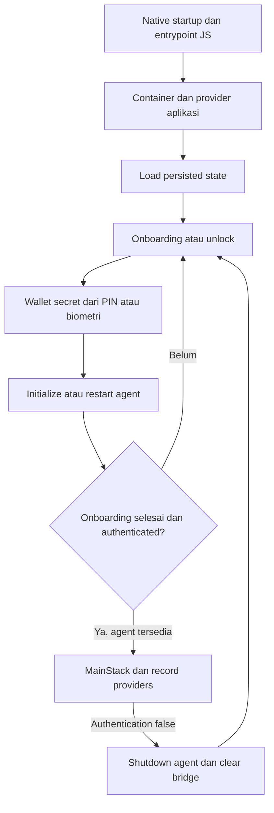

# Arsitektur Bifold Wallet

Dokumen ini menjelaskan implementasi checkout `lissi-wallet`, bukan arsitektur upstream terbaru. Dasar pemeriksaan: kode dan konfigurasi repository pada 20 Oktober 2026. Ini peta implementasi, bukan sertifikasi keamanan atau bukti seluruh alur berhasil di perangkat.

## 1. Lingkup sistem

Bifold adalah wallet identitas digital React Native untuk iOS dan Android. Aplikasi menyimpan credential dan key secara lokal, menerima credential dari issuer, serta mengirim presentation kepada verifier. Credo menangani agent dan protokol identitas; aplikasi menyediakan navigasi, persetujuan pengguna, penyimpanan preferensi, serta integrasi layanan tambahan.

`samples/app` adalah aplikasi yang dirakit dari package workspace. Repository ini tidak menyediakan backend issuer, verifier eksternal, mediator, Trust Registry, atau backend attestation sebagai bagian dari aplikasi sample.



## 2. Struktur repository

| Lokasi | Tanggung jawab | Integrasi pada sample |
| --- | --- | --- |
| `samples/app` | Composition root, konfigurasi Metro, environment, proyek native iOS/Android | Aplikasi utama |
| `packages/core` | Runtime wallet, DI, autentikasi, navigasi, layar default, agent, OpenID, history | Aktif |
| `packages/react-hooks` | React context dan proyeksi record/event Credo | Aktif di subtree agent |
| `packages/ui` | Layar onboarding, PIN, biometri, splash, terms, presentation kustom | Dipasang melalui override DI |
| `packages/oca` | Metadata tampilan, label, branding, overlay credential | Resolver bundle lokal default; resolver remote tersedia |
| `packages/verifier` | Template dan utilitas permintaan proof DIDComm | Dipakai oleh fitur mobile verifier |
| `packages/backup` | Export/import wallet Askar dan layar backup/restore | Service didaftarkan sample; layar melalui settings |
| `packages/trust-registry` | Authorization/recognition TRQP, federation, hooks dan badge | Opsional; perlu enabled, URL, ecosystem DID |
| `packages/openid4vp` | Implementasi OpenID4VP mandiri | Tidak ditemukan caller pada runtime sample; alur aktif memakai Credo |
| `packages/custom-ui` | Implementasi UI proof mandiri | Tidak ditemukan caller sample; berbeda dari `packages/ui` |
| `packages/remote-logs` | Logger remote dan transport Loki | Tidak dipasang pada runtime sample default |
| `packages/react-native-attestation` | Native bridge Apple/Google attestation | Tidak ditemukan caller runtime sample; jalur aplikasi memakai Expo App Integrity |
| `packages/expo-attestation` | Direktori kosong saat pemeriksaan | Bukan implementasi aktif |
| `.yarn/patches` | Patch dependency yang direferensikan manifest | Bagian dari resolusi dependency |
| `.github/workflows` | Build, quality, test, publish | Trigger bergantung workflow dan branch |

Keberadaan package tidak berarti fiturnya aktif. Konfigurasi `.env.example` juga bukan bukti konfigurasi perangkat atau deployment.

## 3. Stack dan resolusi dependency

Manifest root menetapkan Yarn workspaces `packages/*` dan `samples/*`, Yarn `4.9.2`, Node `>=20.19.2 <21.0.0`, TypeScript, React `19.1.0`, React Native `0.81.5`, Expo `~54.0.31`, serta keluarga Credo `0.6.3`. Gunakan `package.json` dan `yarn.lock` sebagai sumber versi, bukan versi upstream.

Package utama menerbitkan hasil build CommonJS, ES module, dan deklarasi TypeScript melalui React Native Builder Bob. Untuk pengembangan sample, `samples/app/metro.config.js` mengawasi package lokal dan memaksa entrypoint source untuk `@bifold/core`, `@bifold/ui`, serta `@bifold/react-hooks`. Package lain tetap mengikuti konfigurasi resolver dan entrypoint masing-masing. Perubahan source tidak selalu identik dengan perubahan output `lib` pada consumer di luar Metro sample.

Sumber: [manifest root](package.json), [manifest aplikasi](samples/app/package.json), [manifest core](packages/core/package.json), [Metro](samples/app/metro.config.js).

## 4. Composition root dan dependency injection

`samples/app/index.js` memuat polyfill dan registrasi native Askar sebelum membuat aplikasi. Urutan composition:

1. Inisialisasi bahasa.
2. Buat `MainContainer` melalui child container `tsyringe`.
3. Buat `AppContainer` sebagai child container untuk override aplikasi.
4. Panggil `createApp(appContainer)`.
5. Bungkus hasilnya dengan `TrustRegistryProvider`, kemudian daftarkan melalui `AppRegistry`.

Core mendaftarkan default melalui `TOKENS`. Sample mengganti layar tertentu, mendaftarkan `BackupService`, serta memasang service/hooks Trust Registry hanya jika konfigurasi lengkap. Perubahan identitas atau perilaku aplikasi sebaiknya mengikuti seam DI yang sudah ada, bukan membuat runtime wallet kedua.

`AppContainer` memilih `CustomOpenIDProofPresentation` dari `@bifold/ui` hanya ketika request cocok dengan guard-nya. Request lain tetap memakai layar default core. `@bifold/ui` tidak memiliki agent atau navigation tree terpisah.

Sumber: [entrypoint](samples/app/index.js), [override aplikasi](samples/app/container-imp.tsx), [container core](packages/core/src/container-impl.ts), [kontrak token](packages/core/src/container-api.ts).

## 5. Startup, autentikasi, dan navigasi

`createApp` membangun shell berisi container, store, theme, navigation, authentication, network, tour, keyboard, error boundary, modal error, dan toast.

`RootStack` memuat persisted state, menjalankan injected agent-setup hook, lalu memilih onboarding atau main stack. Main stack memerlukan onboarding selesai, authentication aktif, dan agent tersedia. Pada subtree main, `AgentProvider` membungkus `OpenIDCredentialRecordProvider`, `ActivityProvider`, dan `MainStack`. Deep-link handling aktif pada main stack.



Agent setup membuat Credo `Agent` dengan React Native dependencies, register transport HTTP/WebSocket, membuka store, membuat AnonCreds link secret jika belum ada, dan memulai mediator pickup. Pickup mencoba v2, v1, kemudian implicit WebSocket. `AgentBridge` menyediakan akses agent bagi service yang berada di luar React context.

Sample memakai `CustomSplash`, bukan splash default core. Perubahan startup harus memperhitungkan override tersebut.

Sumber: [shell aplikasi](packages/core/src/App.tsx), [root navigator](packages/core/src/navigators/RootStack.tsx), [main navigator](packages/core/src/navigators/MainStack.tsx), [agent setup](packages/core/src/hooks/useBifoldAgentSetup.ts), [custom splash](packages/ui/src/screens/CustomSplash.tsx).

## 6. Agent dan protokol

Konfigurasi authoritative berada di [getAgentModules](packages/core/src/utils/agent.ts).

| Modul | Konfigurasi implementasi |
| --- | --- |
| Askar | Store menggunakan `walletSecret.id` dan `walletSecret.key`; pengelolaan KMS dipisahkan |
| KMS | Backend Askar dan secure environment; default `askar`; secure environment `biometricsBacked: false` |
| AnonCreds | Native AnonCreds; registry Indy VDR dan WebVH |
| Indy VDR | Network/pool berasal dari konfigurasi ledger yang diinjeksi |
| DIDComm | Auto-accept connection; credential/proof auto-accept `ContentApproved` |
| Credential exchange | v1 legacy Indy; v2 legacy Indy, AnonCreds, Data Integrity |
| Proof exchange | v1 legacy Indy; v2 legacy Indy, AnonCreds, DIF Presentation Exchange |
| OpenID4VC dan DCQL | Modul terdaftar pada agent |
| DID resolver | `did:webvh`, `did:web`, `did:jwk`, `did:key`, `did:peer`, `did:sov` |
| X509 | Hanya didaftarkan bila `MDOC_TRUSTED_CERTIFICATE_BASE64` tersedia |

Indy VDR tidak otomatis berarti resolver `did:indy` terdaftar. Import push-notification module masih dikomentari; layar onboarding push bukan bukti agent push module aktif.

### DIDComm: penerimaan credential dan proof

Scan/deep link diteruskan ke shared invitation handler. Handler mem-parsing invitation/OOB, menerima atau memakai ulang connection, kemudian menavigasi ke alur delivery. Event Credo memperbarui providers pada `packages/react-hooks`, notification, dan daftar credential.

`CredentialOffer` meminta penerimaan melalui `agent.modules.didcomm.credentials.acceptOffer`. `ProofRequest` mengirim presentation melalui `agent.modules.didcomm.proofs.acceptRequest`. Konfigurasi `ContentApproved` tidak setara dengan menerima seluruh offer/request tanpa persetujuan awal.

Sumber: [handler invitation](packages/core/src/utils/helpers.ts), [scan](packages/core/src/screens/Scan.tsx), [offer](packages/core/src/screens/CredentialOffer.tsx), [proof](packages/core/src/screens/ProofRequest.tsx), [credential provider](packages/react-hooks/src/CredentialProvider.tsx).

### OpenID4VCI dan OpenID4VP

Alur aktif berada pada `packages/core/src/modules/openid`, memakai `agent.modules.openid4vc.holder` dari Credo. Package mandiri `packages/openid4vp` bukan dependency runtime alur ini.

- `offerResolve.tsx` me-resolve offer, memilih credential configuration, dan menyiapkan holder-binding key. Secure-environment binding bersifat opt-in; default mengikuti KMS.
- `resolverProof.tsx` me-resolve authorization request menjadi PEX/DCQL dan credential yang cocok. Resolve tidak langsung mengirim presentation.
- Pengguna memilih credential/claim melalui layar presentation. Fase `shareProof` mengirim response setelah tindakan pengguna.
- `OpenIDCredentialRecordProvider` menyediakan record W3C, SD-JWT, dan mdoc bagi UI, termasuk metadata tampilan.

Sumber: [issuance](packages/core/src/modules/openid/offerResolve.tsx), [presentation](packages/core/src/modules/openid/resolverProof.tsx), [record provider](packages/core/src/modules/openid/context/OpenIDCredentialRecordProvider.tsx), [layar presentation kustom](packages/ui/src/screens/CustomOpenIDProofPresentation.tsx).

## 7. Penyimpanan dan keamanan lokal

| Data | Penyimpanan dan ownership |
| --- | --- |
| Credential, DID/key, exchange dan generic records | Store Askar melalui Credo |
| Wallet salt dan informasi akses key | Service platform `react-native-keychain` |
| Wallet secret yang sedang dipakai | Cache memory pada authentication context |
| Preferensi, onboarding, state aplikasi | `PersistentStorage` berbasis JSON di AsyncStorage |
| Tampilan record dalam React | Context/provider; bukan sumber persistence authoritative |
| Bundle/cache tampilan dan file sementara | Filesystem sesuai service terkait |

PIN dipakai untuk derivasi wallet key dengan Argon2id, bukan disimpan sebagai PIN plaintext oleh alur autentikasi tersebut. Validasi PIN mencoba membuka store Askar dengan derived key. Biometric unlock dapat menyimpan wallet key melalui policy Keychain; mode non-biometri menghapus persisted wallet key setelah secret dimuat. Lockout membersihkan secret memory dan mengubah authentication state.

Biometric unlock, hardware-backed holder binding, dan device attestation adalah mekanisme berbeda. Default KMS tetap Askar; jangan menganggap seluruh private key hardware-backed. AsyncStorage bukan tempat secret hanya karena dipakai oleh wallet.

Sumber: [authentication](packages/core/src/contexts/auth.tsx), [keychain](packages/core/src/services/keychain.ts), [derivasi key](packages/core/src/utils/crypto.ts), [persistent storage](packages/core/src/services/storage.ts).

### Backup dan restore

`BackupService` mengekspor store Askar memakai mnemonic BIP39 sebagai key export, membungkus file database dalam ZIP, lalu menyediakan file melalui filesystem/share sheet. Enkripsi berasal dari export Askar, bukan lapisan enkripsi ZIP terpisah. Tidak ada endpoint cloud backup dalam alur ini.

Restore memakai document picker dan mnemonic, mengimpor store, membuka agent kembali, lalu mencoba reconnect mediator. Implementasi menghapus wallet lama sebelum import selesai dan tidak menunjukkan transactional rollback. Kegagalan import setelah penghapusan berisiko kehilangan wallet lama. File export, clipboard mnemonic, dan share sheet merupakan boundary data sensitif.

Sumber: [backup service](packages/backup/src/services/BackupService.ts), [backup screen](packages/backup/src/screens/BackupWalletScreen.tsx), [restore screen](packages/backup/src/screens/RestoreWalletScreen.tsx).

## 8. Trust Registry, OCA, dan attestation

### Trust Registry

Integrasi diaktifkan melalui `react-native-config`: `TRUST_REGISTRY_ENABLED`, `TRUST_REGISTRY_URL`, dan `TRUST_REGISTRY_ECOSYSTEM_DID`. TTL dan warning/block flags tersedia. Contoh environment menonaktifkan integrasi secara default. Provider root tetap ada, tetapi service/hooks nyata dipasang hanya bila konfigurasi lengkap.

Service mengirim TRQP authorization ke `/v2/authorization` serta recognition ke `/v2/recognition`. Alur federation mencoba issuer authorization lokal, kemudian discovery authority dari `termsOfUse` dan recognition oleh local anchor. Recognition authority pada alur ini tidak disertai query issuer authorization ke registry asing.

Batas implementasi yang perlu dipertahankan dalam evaluasi keamanan:

- Integrasi UI yang teridentifikasi berada pada offer/proof DIDComm. Tidak ditemukan trust hook/gate pada presentation OpenID aktif.
- Warning/confirmation bukan hard authorization gate. Pada cabang accept yang diperiksa, flags `blockUntrustedIssuers` dan `blockUntrustedVerifiers` tidak menjadi hard gate wajib.
- `DEV_MODE` dapat menghasilkan authorization positif melalui bypass development. Itu bukan hasil registry.
- Request service yang diperiksa memakai header JSON tanpa API key/Bearer.
- Trust Registry authorization tidak menggantikan verifikasi signature, status, binding, atau validasi protokol Credo.

Sumber: [konfigurasi](samples/app/config/trustRegistry.ts), [service](packages/trust-registry/src/services/TrustRegistryService.ts), [federated trust](packages/trust-registry/src/hooks/useFederatedTrust.ts), [verifier trust](packages/trust-registry/src/hooks/useVerifierTrust.ts).

### OCA

Resolver default memakai bundle lokal untuk label, branding, dan presentation fields. `RemoteOCABundleResolver` tersedia, tetapi sample tidak mengganti resolver default dengannya. OCA memengaruhi presentasi credential, bukan keputusan validitas signature atau otorisasi issuer.

Sumber: [container default](packages/core/src/container-impl.ts), [resolver lokal](packages/oca/src/legacy/resolver/oca.ts), [resolver remote](packages/oca/src/legacy/resolver/remote-oca.ts).

### Device attestation

Jalur aplikasi memakai `@expo/app-integrity` dan callbacks DI untuk challenge serta pertukaran hasil menjadi JWT. Default attestation dan hardware-backed holder binding nonaktif; sample tidak memasang endpoint challenge/JWT nyata. Freshness challenge dan validasi server bergantung implementasi backend callback, bukan diselesaikan oleh wallet saja.

Sumber: [hook attestation](packages/core/src/hooks/attestation.ts), [custom splash](packages/ui/src/screens/CustomSplash.tsx), [default flags dan callbacks](packages/core/src/container-impl.ts).

## 9. Boundary eksternal dan privasi

| Boundary | Data/operasi | Implikasi |
| --- | --- | --- |
| Issuer | Offer, metadata, token, penerbitan credential | Input eksternal dan komunikasi protokol |
| Verifier | Authorization/proof request dan presentation | Mengungkap credential/claim yang dipilih |
| Mediator | Routing dan pickup pesan DIDComm | Ketersediaan pesan bergantung mediator/network |
| DID/ledger | Resolusi DID, schema, credential definition | Bergantung resolver dan network yang dikonfigurasi |
| Trust Registry | DID entity/authority, action, resource | Lookup mengungkap konteks pemeriksaan; opsional |
| Filesystem/clipboard/share | Backup database dan mnemonic | Salinan keluar dari pengamanan UI wallet |
| Attestation backend | Challenge, hasil platform, JWT | Hanya bila callbacks nyata dipasang |
| Loki | Payload logger remote | Package tersedia tetapi tidak terpasang default |

Logger default adalah `bifoldLoggerInstance`, bukan `RemoteLogger`. Beberapa jalur OpenID mencatat serialized request/submission. Jangan menganggap log sudah memiliki redaction menyeluruh atau aman dikirim ke layanan eksternal.

## 10. Build dan operasi pengembangan

Perintah berikut berasal dari scripts repository; daftar ini bukan klaim semuanya telah dijalankan dalam penyusunan dokumen.

```sh
yarn install --immutable
yarn build
yarn lint
yarn typecheck
yarn test

# Metro dan aplikasi native
yarn workspace bifold-app start
yarn workspace bifold-app ios:setup
yarn workspace bifold-app ios
yarn workspace bifold-app android
```

Native binary diperlukan untuk dependency seperti Askar, AnonCreds, Indy VDR, kamera, Keychain, dan secure environment. File `ios/` dan `android/` adalah bagian implementasi, bukan sekadar konfigurasi JavaScript.

- iOS memakai `RCTReactNativeFactory`; Debug mengambil bundle dari Metro, Release mengambil `main.jsbundle`.
- iOS menetapkan `RCT_NEW_ARCH_ENABLED=0` pada Podfile dan `RCTNewArchEnabled=false` pada plist.
- Android menetapkan `newArchEnabled=false`, `hermesEnabled=true`.
- Bundle identifier iOS yang tercatat pada proyek adalah `org.reactjs.native.example.AriesBifold`, bukan `com.ariesbifold`. Perintah device launch harus mengikuti identifier build aktual.
- Setelah mengubah dependency native atau architecture flag, regenerasi Pods/build native diperlukan.
- Workflow quality saat ini dipicu untuk `main`; push ke branch `lissi-wallet` tidak otomatis membuktikan workflow itu berjalan.

Sumber: [scripts root](package.json), [scripts sample](samples/app/package.json), [AppDelegate](samples/app/ios/AriesBifold/AppDelegate.swift), [Podfile](samples/app/ios/Podfile), [plist](samples/app/ios/AriesBifold/Info.plist), [proyek iOS](samples/app/ios/AriesBifold.xcodeproj/project.pbxproj), [Gradle properties](samples/app/android/gradle.properties), [workflow quality](.github/workflows/quality.yaml).

## 11. Batas implementasi yang belum boleh dianggap selesai

Temuan berikut berasal dari inspeksi kode, bukan reproduksi bug runtime pada tugas dokumentasi ini:

- Parameter transaction cache dikirim oleh setup, tetapi pemanggilan `indyVdr.setLedgerTxnCache` di `getAgentModules` masih dikomentari. Jangan menyatakan konfigurasi tersebut benar-benar mengaktifkan cache.
- Warmup schema/credential definition memakai `forEach(async ...)`, sehingga selesainya fungsi bukan bukti semua request warmup selesai.
- Helper migrasi legacy Indy SDK ke Askar masih memiliki langkah updater yang dikomentari. Jangan menganggap pemanggilan helper membuktikan migrasi data legacy berhasil.
- Beberapa layar lama masih memakai namespace `agent.modules.credentials/proofs/connections`, sedangkan jalur DIDComm baru memakai `agent.modules.didcomm.*`. Konsistensi jalur tersebut perlu verifikasi saat disentuh.
- Dukungan format atau resolver yang terdaftar bukan bukti interoperabilitas semua issuer/verifier, validasi lengkap setiap format, atau keberhasilan seluruh alur di perangkat.

Sumber: [agent modules](packages/core/src/utils/agent.ts), [setup](packages/core/src/hooks/useBifoldAgentSetup.ts), [migration](packages/core/src/utils/migration.ts), [credential details](packages/core/src/screens/CredentialDetails.tsx), [proof details](packages/core/src/screens/ProofDetails.tsx), [mobile verifier](packages/core/src/screens/MobileVerifierLoading.tsx).

## 12. Panduan perubahan

- Konfigurasi aplikasi, service injection, dan override layar: mulai dari `samples/app/container-imp.tsx` serta token core.
- Perubahan lifecycle/storage/protokol agent: mulai dari `useBifoldAgentSetup.ts` dan `utils/agent.ts`.
- Perubahan OpenID aktif: ubah `packages/core/src/modules/openid` dan layar yang dipilih router sample, bukan otomatis package `openid4vp` atau `custom-ui`.
- Perubahan tampilan credential: pisahkan OCA/metadata dari verifikasi kriptografi dan kebijakan Trust Registry.
- Perubahan secret, backup, atau restore: periksa ownership store, shutdown/reopen agent, jalur kegagalan, dan salinan sensitif di luar wallet.
- Saat wiring, storage, protocol module, atau default security berubah, perbarui bagian terkait dokumen ini. Kode dan konfigurasi tetap menjadi sumber kebenaran.
